# Desktop Vocabulary Coach

常驻 Windows 系统托盘的英语单词学习工具：在合适的时机随机弹出一张轻量浮动单词卡片，
用户用「认识 / 模糊 / 不认识」快速反馈，系统据此安排后续复习。核心学习功能以离线为主。

- 当前版本：`0.9.0`
- 目标平台：Windows 10 / 11 x64
- 技术栈：.NET 10 + WPF + EF Core + SQLite + Generic Host + CommunityToolkit.Mvvm
- 代码仓库：[github.com/zhaoxiaozhao/desktop-vocabulary-coach](https://github.com/zhaoxiaozhao/desktop-vocabulary-coach)
- 下载：[Releases](https://github.com/zhaoxiaozhao/desktop-vocabulary-coach/releases/latest)
- 官网：https://desktop-vocabulary-coach.zhaojia5201314.workers.dev
- 设计文档：[docs/Desktop_Vocabulary_Coach_Design.md](docs/Desktop_Vocabulary_Coach_Design.md)
- 开发计划：[docs/ROADMAP.md](docs/ROADMAP.md)

## 当前进度

| Sprint | 内容 | 状态 |
| --- | --- | --- |
| 1 | 托盘常驻、主窗口、手动浮动卡片、DI/Host、单元测试 | ✅ 已完成 |
| 2 | SQLite + EF Core、18,914 词离线词库、JSON/CSV 导入、本地查词 | ✅ 已完成 |
| 3 | 随机调度、勿扰、每小时上限、空闲/全屏/锁屏检测、暂停恢复 | ✅ 已完成 |
| 4 | 反馈闭环、SM-2 复习算法、到期复习优先 | ✅ 已完成 |
| 5 | 自适应难度、设置界面、今日统计、备份 | ✅ 已完成 |
| 6 | AI 增强、首次启动向导、安装包、DPI/多屏/长跑验收 | ✅ 已完成 |

Sprint 6 界面（离屏渲染自真实 XAML）：

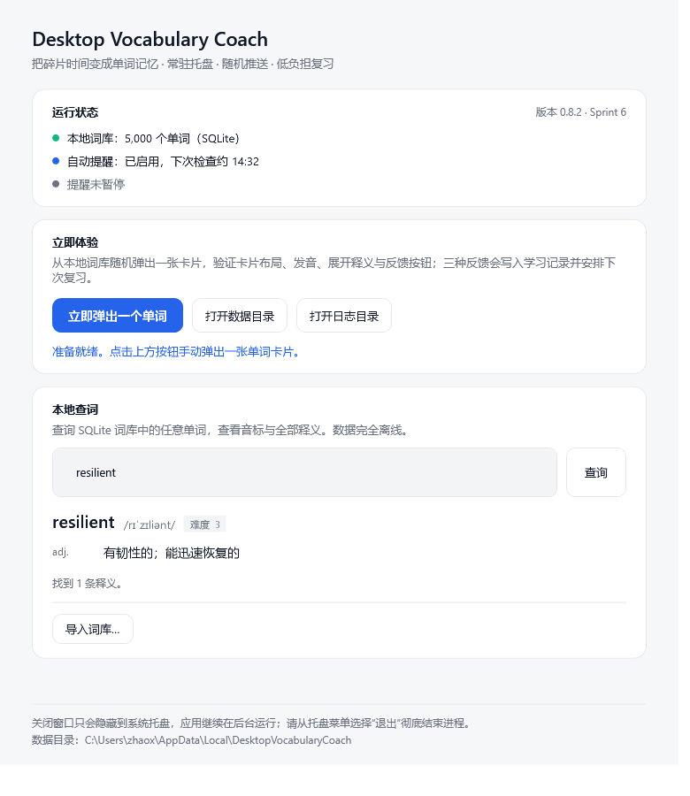

| 折叠 | 展开 |
| --- | --- |
| 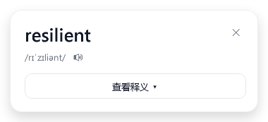 | 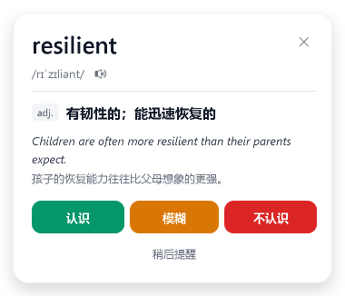 |

| 首次启动 | 设置 | 今日统计 |
| --- | --- | --- |
|  | 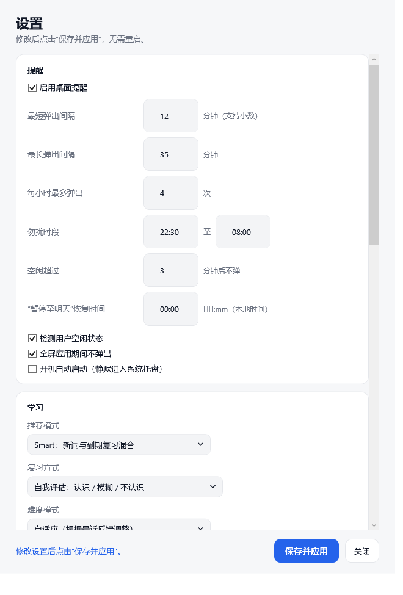 |  |

深色主题（切换后立即整体生效，包括查词结果）：

| 主窗口 | 设置 |
| --- | --- |
| 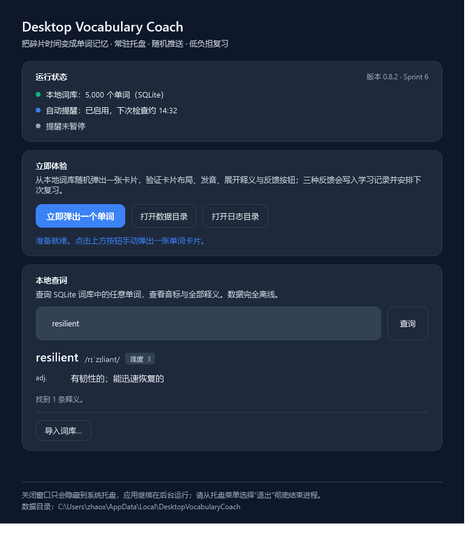 | 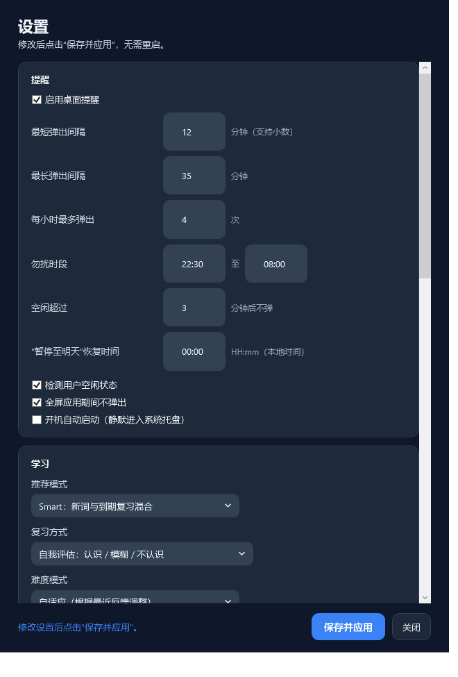 |

深色卡片：

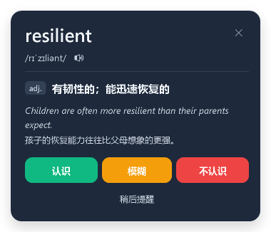

选择题模式（看词选义：未作答 / 答错 / 选择 E 不认识）：

| 题目 | 答错反馈 | E：不认识 |
| --- | --- | --- |
| 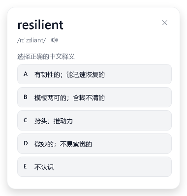 | 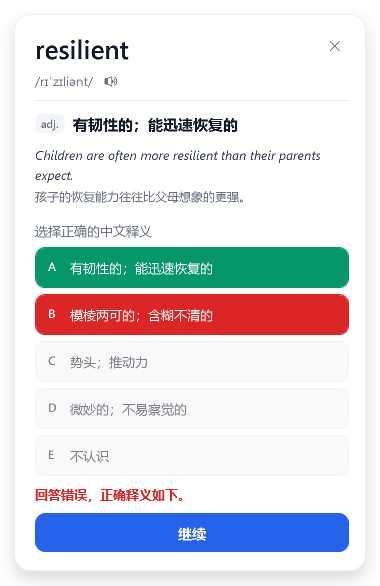 | 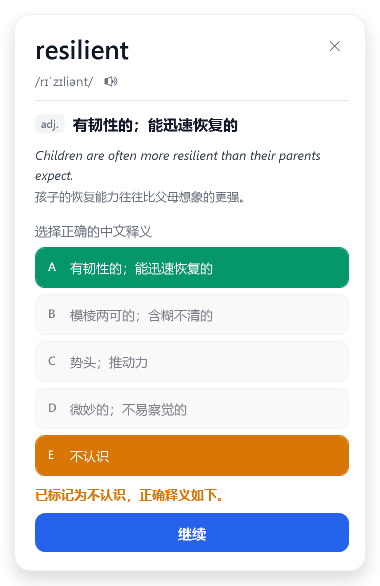 |

反向选择题（看义选词：作答前标题为中文释义，选项为英文单词）：

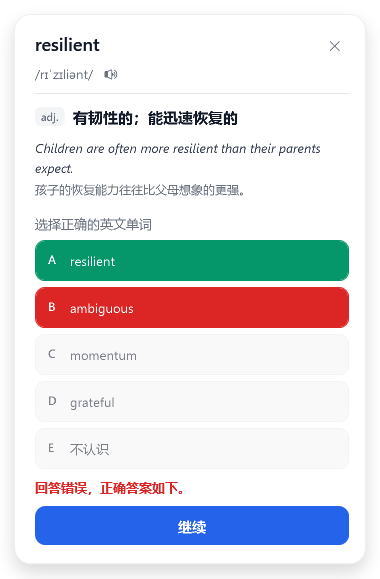

句子填空（作答后显示答案、翻译与语法/固定句式）：

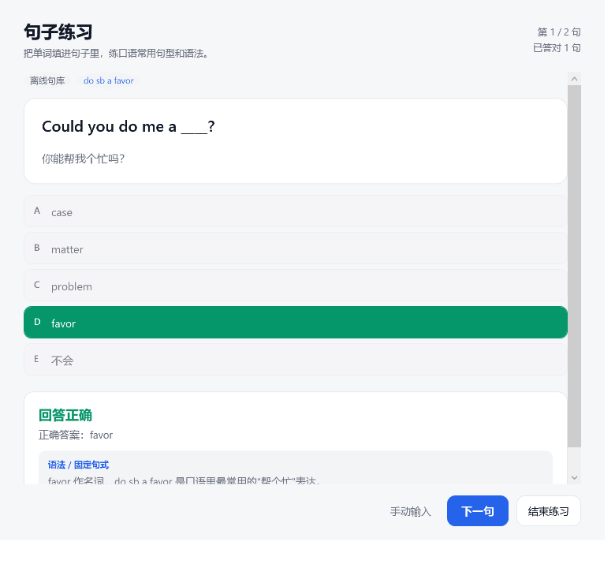

生词捕获（已收录 / 未收录 / 生词本）：

| 捕获确认 | 未收录需填释义 | 生词本 |
| --- | --- | --- |
| 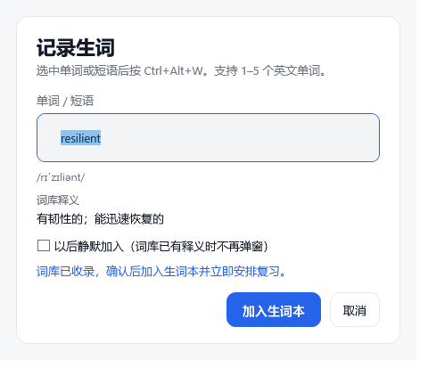 |  | 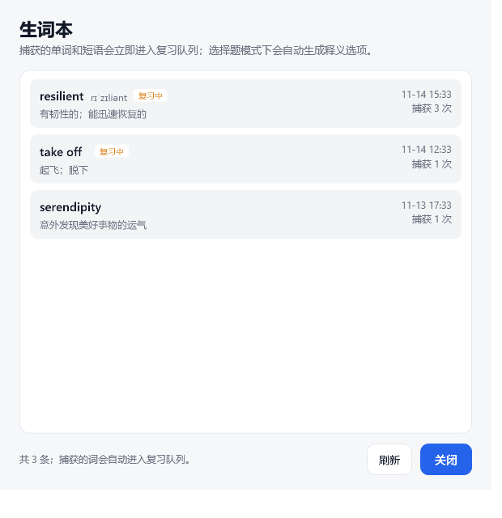 |

## 环境要求

本机已实际验证以下环境：

```text
.NET SDK 10.0.400-preview.0.26322.102
Microsoft.EntityFrameworkCore 10.0.15
Microsoft.WindowsDesktop.App 10.0.9
Windows 10.0.26300 (x64)
```

需要 `.NET 10 SDK`（含 Windows Desktop 运行时）。未安装时请先安装 SDK，项目不会自动降级到旧版本。

## 构建、测试与运行

```powershell
dotnet build VocabularyCoach.sln
dotnet test VocabularyCoach.sln
dotnet run --project src/VocabularyCoach.App
```

也可以直接运行构建产物：

```text
src\VocabularyCoach.App\bin\Debug\net10.0-windows\VocabularyCoach.exe
```

首次启动会在 `%LocalAppData%\DesktopVocabularyCoach\vocabulary.db` 自动创建数据库、
执行 EF 迁移并导入 18,914 个内置单词（首次约 5 秒），随后显示首次启动向导；之后启动不会重复导入。

## 安装包

```powershell
powershell -ExecutionPolicy Bypass -File installer\build-installer.ps1
```

产物：`artifacts/installer/DesktopVocabularyCoach-Setup-<version>.exe`（自包含 win-x64，约 56 MB）。
详细说明（安装/升级/卸载、中文语言文件来源）见 [installer/README.md](installer/README.md)。

## 官网（静态站点）

`site/` 是一个可直接部署到 Cloudflare Pages 的纯静态落地页：无构建步骤、无第三方脚本、
深色响应式布局，展示功能、截图、安装步骤、隐私说明与常见问题。

- 线上地址：https://desktop-vocabulary-coach.zhaojia5201314.workers.dev
- 安装包托管在 GitHub Releases（56.7 MB，超过 Pages 25 MiB 单文件限制）。
- 部署前只需修改 `site/config.js` 中的 `downloadUrl`（版本、大小与 SHA256 可自动生成）。
- 本地预览：`python -m http.server 8123 --directory site`。
- 一键部署（需要已登录的 Cloudflare 账号）：

```powershell
powershell -ExecutionPolicy Bypass -File tools\deploy-site.ps1
```

`site/config.js` 已配置 GitHub Releases 下载地址；如需换地址，追加
`-DownloadUrl "https://..."` 即可。

详细说明（R2 上传、自定义域名、中国大陆访问注意事项）见 [site/README.md](site/README.md)。

## 已实现功能（Sprint 1–6 + 0.7.x / 0.8.x / 0.9.x 增量）

- **解决方案骨架**：`Core → Application → Infrastructure → App` 分层；`Core` 不引用 WPF/EF Core。
- **Generic Host + DI + 配置 + 日志**：后台服务随宿主启动/停止；支持 `CancellationToken`；
  `appsettings.json` 配置卡片宽度、自动关闭秒数、动画开关等。
- **主窗口**：运行状态（词库数量、调度器、暂停状态）、手动弹卡、本地查词、词库导入、
  打开数据/日志目录；关闭窗口只隐藏到托盘。
- **系统托盘**：显示主窗口、暂停提醒（30 分钟 / 1 小时 / 至明天）、恢复提醒、立即弹出单词、
  今日学习统计（占位）、设置（占位）、退出；双击托盘图标打开主窗口。
- **浮动卡片**：无边框、置顶、右下角定位、可拖动、不抢键盘焦点（`WS_EX_NOACTIVATE`），
  折叠状态显示单词/音标/发音/查看释义，展开后显示词性、释义、例句和三种反馈按钮；
  60 秒超时自动关闭；关闭/超时/稍后提醒都不会被记为「已掌握」。
- **本地词库（Sprint 2）**：
  - EF Core + SQLite，库文件位于 `%LocalAppData%\DesktopVocabularyCoach\vocabulary.db`。
  - 迁移包含 `Words / WordDefinitions / UserWordProgress / ReviewLogs / LearningSessions /
    UserLearningProfile / AppSettings / AiGenerationCache`，关键字段建有索引与唯一约束。
  - 内置 18,914 词种子词库（ECDICT，MIT），难度 1–4、词频、音标、词性、中文释义。
  - JSON/CSV 导入器：按规范化单词去重、可重复执行、分批事务写入，不覆盖用户学习进度，
    返回新增/更新/跳过/失败统计；主窗口「导入词库…」可直接选择文件。
  - 本地查词：大小写与首尾空白不敏感的精确查询，展示音标、难度与全部释义。
  - 卡片取词改为随机选择「难度不超过当前档位 + 词频靠前」的未学新词。
- **随机后台调度（Sprint 3）**：
  - 12–35 分钟随机间隔（可配置小数，便于缩短到秒级验证），等待分片执行，暂停/退出数秒内生效。
  - 勿扰时段（默认 22:30–08:00，支持跨零点）、每小时上限（默认 4 次，滑动窗口）。
  - 系统状态检测：空闲超过 3 分钟、锁屏/会话断开/安全桌面、前台全屏应用时一律不弹；
    检测失败采用保守策略（暂缓并记录日志）。
  - 状态不允许时延迟 2 分钟重试；恢复后不会连续补弹，弹出成功总是重新随机等待。
  - 托盘暂停 30 分钟/1 小时/至明天立即生效；主窗口显示「下次检查约 HH:mm」。
- **反馈与复习闭环（Sprint 4）**：
  - 认识/模糊/不认识分别写入 `UserWordProgress`、`ReviewLogs`、`LearningSessions`，单次反馈在一个事务中提交。
  - 简化 SM-2：认识 1 天 → 3 天 → 上次间隔 × 难度系数；模糊短间隔；不认识 10 分钟后重学并累计遗忘；
    难度系数限制 1.3–3.0，间隔限制 10 分钟–365 天，间隔 ≥60 天标记为已掌握。
  - 关闭、超时、稍后提醒只记录学习会话，不更新掌握状态，也不写复习日志。
  - 到期复习优先：按到期时间升序取词，逾期超过 6 小时无条件复习；复习压力低时按 60/40 目标混合新词。
  - 卡片会话记录来源（自动/手动）、展示时长与最终结果（含 Dismissed/Snoozed/Timeout）。
- **选择题答题（0.7.x 起，0.9.0 增加反向）**：
  - 设置 → 学习 → 复习方式：自我评估 / 看词选义 / 看义选词 / 混合（自我评估 + 正反选择）。
  - **看词选义**：显示英文单词，从正确释义 + 3 个同难度干扰释义中选出答案。
  - **看义选词**：显示中文释义，从正确英文单词 + 3 个英文干扰词中选出答案；
    标题在作答前显示中文，音标与英文单词在作答后才揭示。
  - 两种方向都在 A–D 之后固定追加 **E：不认识**；选择 E 可直接标记为不认识而无需猜测。
  - 答对记为「认识」，答错或选择 E 记为「不认识」；作答后立即用绿/红色标出正确与错误选项，
    选择 E 时用橙色标记，并揭示单词、释义、例句与 AI 增强内容，点「继续」关闭卡片。
  - 反向干扰词会排除中文释义与正确答案完全相同的词条，降低多解歧义；
    干扰项不足 3 个时自动回退到自我评估；关闭/超时仍不记录掌握状态。
- **句子填空练习（0.9.0 增量）**：
  - 主窗口「句子练习」或托盘「句子练习…」打开，每组 10 句。
  - 显示口语句子 + 中文翻译，空格处填入合适的单词；可点 A–D 选择，也可切换「手动输入」。
  - 作答后显示正确答案、中文翻译、固定句式与语法/时态说明；错误会立即纠正。
  - 句子优先由 AI 生成（启用 AI 时一次请求生成一组）；AI 关闭或失败时使用
    `Seed/sentences.seed.json` 离线句库（约 70 条口语/语法句）。
  - 答对记「认识」、答错记「不认识」，以 `SentencePractice` 来源写入现有 SM-2 复习闭环；
    词库未收录的超高频词（go/take/see 等）仍可练习，但不写入复习进度。
  - 会话结束显示答对数量，可「再来一组」。
- **自适应与产品设置（Sprint 5）**：
  - 最近 20 次有效反馈统计；认识 > 80% 且不认识 < 10% 时难度上调一档、新词倾向 +0.05；
    不认识 > 35% 时难度下调一档、新词倾向 -0.1；样本少于 10 次不调整，每次只移动一档。
  - 设置窗口：提醒（开关/间隔/每小时上限/勿扰/空闲/全屏/暂停至明天时间）、学习（推荐模式/复习方式/难度模式/手动难度/新词倾向）、
    显示（主题/音标/自动展开/动画）、数据备份恢复、AI 配置。
  - 设置保存到 SQLite（`AppSettings` 表 JSON），立即生效，重启后保留；`appsettings.json` 仅作为默认值。
    保存设置会清除自适应产生的新词比例偏好，使用户手动设置的倾向立即生效。
  - 今日统计窗口：弹卡总数、认识/模糊/不认识、关闭/稍后提醒/超时、今日学习词数、待复习数。
  - 数据库备份（SQLite 在线备份，可在运行中执行）与恢复（校验 Words 表，恢复后提示重启）。
  - 浅色/深色主题：切换后立即应用到所有已打开窗口与后续卡片。
- **AI 可选增强（Sprint 6）**：
  - `IVocabularyEnrichmentProvider` 抽象 + 离线 Mock + OpenAI-compatible 实现。
  - 内置中美主流服务预设：OpenAI、Anthropic、Gemini、DeepSeek、Moonshot Kimi、阿里通义千问、
    智谱 GLM、SiliconFlow，以及自定义 Base URL；模型名称可改。
  - 缓存优先：卡片只读取 `AiGenerationCache`，无缓存时后台排队生成，下一次出现该词时展示；
    请求 20 秒超时、失败静默降级，不阻塞 UI、不影响本地词库。
  - 只发送当前单词与本地中文释义，不上传学习记录；API Key 使用 Windows DPAPI 加密保存，
    不写入配置文件、数据库或日志。
  - 设置页可测试连接、清除 Key；Mock 模式无需网络与 Key 即可演示。
- **首次启动与发布（Sprint 6）**：
  - 首次启动向导：英语水平（含自适应）、提醒节奏、勿扰时段、是否立即测试弹卡。
  - 浅/深色主题、PerMonitorV2 DPI 支持；卡片按鼠标所在显示器的工作区定位。
  - Inno Setup 安装包（按用户安装、自包含 win-x64），升级保留数据，卸载不删除学习数据。
- **生词捕获（0.8.0 增量）**：
  - 全局热键 `Ctrl+Alt+W`：读取任意应用当前选中的文字（UI Automation 优先，
    失败时模拟 `Ctrl+C` 读取剪贴板并恢复原内容）。
  - 支持 1–5 个英文单词或短语（可含连字符/撇号），自动去重、过滤 URL/数字/整句。
  - 捕获确认窗：词库已收录可直接加入；未收录时要求填写中文释义；可勾选「以后静默加入」。
  - 捕获后默认显示托盘气泡；可在设置中关闭「捕获后显示托盘提示」，此时静默捕获完全无窗口/气泡。
  - 捕获成功后将单词/短语设为立即到期，进入现有复习队列，复用 SM-2、选择题与统计。
  - 不保存来源应用、窗口标题或上下文句子。
  - 托盘新增「记录生词（Ctrl+Alt+W）」与「生词本」；生词本可查看释义、捕获次数、复习状态。
  - 内置词库扩充到 18,914 词，降低专业词汇查不到的概率。
- **开机自动启动（0.8.2 增量）**：
  - 设置 → 提醒 → 「开机自动启动（静默进入系统托盘）」。
  - 通过当前用户注册表 `HKCU\...\Run` 注册，无需管理员权限；命令行带 `--startup`，启动时不显示主窗口。
  - 关闭开关立即删除启动项；程序升级/移动路径时会在下次启动自动修正路径；卸载安装包会清理启动项。
- **30 天试用与离线激活（0.9.0 增量）**：
  - 首次启动自动开始 30 天全功能试用，无需注册；主窗口显示剩余天数。
  - 到期后仅暂停自动弹卡、手动弹卡与生词捕获；查词、备份、导出与全部学习数据保留。
  - 试用状态同时写入 `trial.json` 与当前用户注册表，取最早首启时间；时钟回拨超过 1 天按到期处理。
  - 激活码使用 ECDSA P-256 离线验签，不联网、不绑定机器；激活后 DPAPI 加密保存到 `license.dat`。
  - 私钥与发码工具见 [docs/licensing-and-updates.md](docs/licensing-and-updates.md)。
- **自动更新（0.9.0 增量）**：
  - 启动 30 秒后检查一次，之后每 24 小时检查；托盘「检查更新…」可手动检查。
  - 更新清单使用同一把离线密钥签名；安装包下载后校验 SHA256，再静默安装并自动重启。
  - 清单地址支持多个镜像（阿里云 OSS 优先、GitHub 兜底）。
  - 更新清单与发版流程见 [docs/licensing-and-updates.md](docs/licensing-and-updates.md)。
- **发音**：系统 TTS（`System.Speech`），不可用时自动禁用按钮并降级。
- **稳定性**：单实例保护、未处理异常落盘、按天滚动日志、退出时先停止宿主再释放资源。

## 实际验收结果

本轮实际执行结果（2026-11-16）：

```text
dotnet build VocabularyCoach.sln   → 0 error, 0 warning
dotnet test  VocabularyCoach.sln   → 223 passed
  Core 33 + Application 147 + Infrastructure 43
```

运行时自动化场景（在真实 App 启动路径下执行）：

```text
首次启动：EF 迁移完成 → 内置词库导入 18,914 词（约 3–5 秒）
第二次启动：seed.version 命中 → 种子导入「未执行」，词库仍为 18,914 词
查词：输入 "Season"（大写）→ 命中 "season"，返回 2 条释义（大小写不敏感）
弹卡：从 SQLite 随机取词成功（如 special / season）
      卡片 WS_EX_NOACTIVATE + WS_EX_TOOLWINDOW，弹出前后前台窗口不变
      关闭卡片 → Dismissed，未记录掌握状态
关闭主窗口 → 隐藏到托盘且进程存活；托盘路径可重新显示
退出 → 「弹出调度器已停止」→「后台服务已停止」→ 进程正常结束
```

随机调度运行时验证（使用真实 App + Windows 系统状态检测，临时把 appsettings 间隔改为 1.2–1.8 秒）：

```text
正常状态：自动弹出 century → 3 秒超时关闭 → 自动弹出 reach
         达到每小时上限 2 次 → 日志「跳过本次自动弹卡：最近一小时已弹出 2/2 次」
全屏检测：检测到前台全屏应用 → 日志「跳过本次自动弹卡：前台为全屏应用」
暂停/恢复：自动化测试验证暂停期间不弹、恢复后重新随机等待再弹
停止：StopAsync 在 2 秒内完成，调度循环立即退出
```

复习闭环运行时验证（真实 App + 真实 SQLite）：

```text
弹出 "kill" → 点击“认识” → 卡片关闭
数据库：UserWordProgress repetition=1 intervalDays=1 status=Learning due=次日
        ReviewLogs=1（Good / Recognized / Manual）
        LearningSessions=1（Recognized / Manual / duration≈1.1s）
再次“认识” → intervalDays=3（自动化测试覆盖）
“不认识” → repetition=0、lapse+1、10 分钟后重学（自动化测试覆盖）
关闭/超时 → 只有 LearningSession，无进度与复习日志（自动化测试覆盖）
逾期复习优先 → 1 天以上逾期词优先于新词（自动化测试覆盖）
```

设置、自适应、统计与备份验证：

```text
真实启动：迁移 AddAdaptiveDifficulty 成功；用户设置加载（提醒=True / Light / Smart）
设置持久化：保存后重新创建 SettingsService，全部字段与保存值一致（自动化测试）
自适应上调：20 次反馈中 17 次认识、3 次模糊 → 难度 2→3，新词比例 0.60→0.65
自适应下调：8 次不认识 / 20 → 难度 3→2，新词比例 0.60→0.50
样本不足：5 次反馈不调整难度
统计一致性：7 条今日会话 → 弹卡 7 次、认识 2/模糊 1/不认识 1/关闭 1/超时 1/稍后 1；
             昨日记录不计入；待复习数量与 UserWordProgress 一致
备份/恢复：在线备份文件可读且词条一致；恢复覆盖目标库；非本应用数据库被拒绝
```

Sprint 6 验证：

```text
AI：Mock Provider 离线生成并写入缓存；OpenAI-compatible 请求路径/鉴权/JSON 解析通过测试；
    未配置 Key 时测试连接返回明确失败，Provider 不被调用
DPAPI：保存 Key 后文件不含明文；读取往返一致；删除后读取为 null
AI 缓存：同一单词重复保存只保留一行，内容更新生效
首次启动：向导保存水平/节奏/勿扰并标记已完成，重启不再显示
安装包：成功编译 DesktopVocabularyCoach-Setup-0.9.0.exe（约 56 MB）；
        `/UPDATE` 静默升级 → 自动重启 0.9.0，学习数据保留。
        静默安装 → 启动 → 静默卸载：安装目录删除，%LocalAppData% 学习数据保留
DPI/多屏：进程使用 PerMonitorV2；卡片按鼠标所在屏幕工作区定位（单屏自动化验证，混合 DPI 待人工验收）
```

选择释义模式验证：

```text
题目：resilient 显示 A–D 四个释义选项（1 正确 + 3 干扰）以及固定的 E：不认识，释义与例句在作答前隐藏
答错：正确项变绿、所选项变红、其余淡化，显示「回答错误，正确释义如下」并揭示释义/例句
选择 E：E 项变橙，显示「已标记为不认识，正确释义如下」，同时高亮正确释义
继续：点击「继续」关闭卡片；答对 → Recognized，答错或选 E → Unknown（写入进度/复习日志）
回退：干扰项不足 3 个时自动使用自我评估，不影响学习
```

生词捕获验证：

```text
词库：种子版本 3 导入 18,914 词（新增 13,914 / 更新 3,909 / 跳过 1,091），已学进度不变
捕获已有词：创建/更新 WordCaptures，UserWordProgress.DueAt=now，下一次复习优先出现
捕获未收录词：必须填写中文释义，创建 Words + WordDefinitions + 进度，事务提交
短语：take off 可捕获、入库并进入到期复习（数据库集成测试）
热键：真实应用启动时 Ctrl+Alt+W 注册成功（无占用警告）
界面：捕获确认窗、未收录释义输入、生词本均通过离屏渲染检查
```

测试覆盖的关键场景：

- 词库导入新增单词与多条释义；重复导入 `Added=0 / Skipped=2`，不产生重复单词。
- 更新词条释义与难度时，`UserWordProgress` 的重复次数与间隔保持不变。
- 非法词条返回 `Failed` 统计与可读错误，不影响同一文件中的有效词条。
- CSV 多行合并为同一单词的多条释义；缺少必需列时整体拒绝并给出错误。
- 查词大小写不敏感、释义按顺序返回；取新词遵守难度上限并跳过已学词。
- 调度器启动/停止、卡片并发闸门与取消传播（Sprint 1 测试保持通过）。
- 勿扰时段跨零点边界、每小时滑动窗口、随机间隔范围、系统状态判定（Sprint 3 新增）。
- 调度循环集成测试：允许状态自动弹卡、锁屏/勿扰/暂停时不弹、恢复后弹、达到上限后停止。
- 复习算法：首次/第二次/第三次认识的间隔、模糊短间隔、不认识重置与遗忘计数、
  难度系数上下限、最长间隔与掌握状态（Sprint 4 新增）。
- 持久化集成测试：三种反馈的进度/日志/会话写入、关闭只写会话、第二次认识延长间隔、
  到期查询按逾期排序、当前难度读取。
- 推荐规则：严重逾期优先、无到期时取新词、低压力混合新词、队列压力高时优先复习。
- 自适应：高认识率上调、高不认识率下调、样本不足不调整、手动模式只更新统计、难度上下界。
- 设置：保存/加载全字段往返、无数据时使用默认值、非法勿扰时段拒绝、越界值归一化。
- 统计：会话计数与动作分布、逾期数量、今日学习词数、跨天数据排除。
- 备份：在线备份一致性、恢复覆盖目标库、拒绝非本应用数据库。
- AI：响应解析（纯 JSON/代码块/snake_case/非法内容）、Mock/远程 Provider 选择、
  缓存命中、失败降级、测试连接、DPAPI 加密往返、AI 缓存表读写。
- 设置：AI 字段随设置持久化；首次启动向导保存后标记已完成。
- 选择题：干扰项生成/去重/不足回退、问答模式的附加与回退、正确/错误结果映射。

数据库与日志路径：

```text
%LocalAppData%\DesktopVocabularyCoach\vocabulary.db
%LocalAppData%\DesktopVocabularyCoach\logs\app-yyyyMMdd.log
```

## 调度配置（appsettings.json）

| 配置项 | 默认值 | 说明 |
| --- | --- | --- |
| `Scheduler:MinIntervalMinutes` | 12 | 最短随机间隔（分钟，支持小数） |
| `Scheduler:MaxIntervalMinutes` | 35 | 最长随机间隔 |
| `Scheduler:MaxPopupsPerHour` | 4 | 每小时自动弹卡上限 |
| `Scheduler:QuietHoursStart` | 22:30 | 勿扰开始（本地时间） |
| `Scheduler:QuietHoursEnd` | 08:00 | 勿扰结束；起止相同表示禁用 |
| `Scheduler:IdleThresholdMinutes` | 3 | 空闲超过该值不弹 |
| `Scheduler:EnableIdleDetection` | true | 是否启用空闲检测 |
| `Scheduler:DetectFullscreen` | true | 是否启用全屏检测 |
| `Scheduler:RecheckDelayMinutes` | 2 | 状态不允许时的重试间隔 |

修改后需重启应用（Sprint 5 会提供设置界面）。

> Sprint 5 起，设置界面保存的值写入数据库并覆盖以上默认值；`appsettings.json` 只作为
> 首次运行/重置后的默认配置。设置窗口中的「保存并应用」会立即更新调度、检测、卡片与推荐。

## 推荐配置（appsettings.json）

| 配置项 | 默认值 | 说明 |
| --- | --- | --- |
| `Recommendation:NewWordRatio` | 0.6 | 复习压力低时的新词目标比例（0–1） |
| `Recommendation:ReviewPressureThreshold` | 2 | 到期复习数 ≤ 该值时视为压力低 |
| `Recommendation:OverdueGraceHours` | 6 | 逾期超过该小时数时无条件复习 |
| `Recommendation:ReviewCandidateLimit` | 20 | 一次推荐读取的到期词上限 |

> 设置界面中的「新词倾向」会覆盖 `Recommendation:NewWordRatio`；自适应下调后还会在
> `UserLearningProfile` 中保存更低的倾向值，推荐时优先使用该值。

## AI 配置（设置界面）

- 默认关闭；关闭时所有核心功能完全不依赖网络。
- 服务商预设：OpenAI、Anthropic、Gemini、DeepSeek、Moonshot Kimi、阿里通义千问、智谱 GLM、
  SiliconFlow、自定义（任意 OpenAI-compatible Base URL）、Mock（离线演示）。
- 需要填写 Base URL、模型名称与 API Key；「测试连接」会用 `resilient` 发起一次真实请求。
- 生成内容只用于卡片例句/简释/易混词提示；首次遇到单词时后台生成，下一次展示生效。
- Key 文件：`%LocalAppData%\DesktopVocabularyCoach\ai.key`（DPAPI 加密，不可跨用户/机器复制）。

## 手动验收步骤

1. 如已有旧数据，先备份或删除 `%LocalAppData%\DesktopVocabularyCoach\vocabulary.db`。
2. 启动 `VocabularyCoach.exe`，确认状态栏显示「本地词库：18,914 个单词（SQLite）」。
3. 关闭并重新启动，确认词库数量仍为 18,914，日志中没有重复导入。
4. 在「本地查词」输入 `Season` 回车，确认命中 `season` 并显示音标、难度和释义；
   输入不存在的单词，确认显示「未找到单词」。
5. 点击「立即弹出一个单词」，确认卡片内容来自词库，且弹出时不抢当前输入焦点。
6. 点击「导入词库…」，选择 `data/seed/words.seed.json`，确认统计显示「新增 0，更新 0，
   跳过 18914」（说明导入幂等）；导入期间按钮禁用、完成后词库数量刷新。
7. **自动调度快速验证**（可选）：临时把 `appsettings.json` 的 `Scheduler` 改为
   `MinIntervalMinutes=0.02`、`MaxIntervalMinutes=0.03`，`QuietHoursStart`/`QuietHoursEnd`
   都设为 `00:00`，并临时把 `EnableIdleDetection`/`DetectFullscreen` 设为 `false`。
   重启后应在数秒内自动弹卡；达到 `MaxPopupsPerHour` 后停止并写入限流日志。
8. 恢复默认配置，确认勿扰时段、空闲超过 3 分钟、全屏应用、锁屏时日志出现
   「跳过本次自动弹卡：…」且没有卡片弹出。
9. 托盘选择「暂停提醒 30 分钟」，确认暂停期间不再自动弹卡；恢复正常后重新随机等待，
   不会连续补弹。
10. 其余 Sprint 1 手工项保持有效：折叠/展开、发音、反馈按钮、关闭语义、拖动、
   托盘重开、托盘退出。
11. 反馈持久化：点击「认识」后日志出现「下次复习 时间」；关闭/超时不会出现该日志。
    可使用任意 SQLite 客户端查看 `vocabulary.db` 的 `UserWordProgress`、`ReviewLogs`、
    `LearningSessions` 三张表验证数据一致。
12. 托盘「设置」：确认设置窗口可打开；修改间隔/勿扰/每小时上限后保存，确认状态栏「下次检查」变化，
    重启后设置保留；把「最短/最长间隔」改回默认或使用设置界面的数值。
13. 设置中的「难度模式」切到手动并选择 1–4，确认新词难度按上限取词；切回自适应。
14. 托盘「今日学习统计」：对比当天弹卡次数与你实际操作次数，确认认识/模糊/不认识、
    关闭/稍后/超时与卡片操作一致。
15. 设置「备份数据库…」保存到桌面；删除或改名当前数据库后，用「从备份恢复…」选择备份，
    确认提示重启，重启后词条与进度还在。
16. 设置「主题」改为深色并保存，关闭并重新打开主窗口/弹卡，确认新窗口使用深色；
    恢复浅色同理。
17. **首次启动向导**：备份并删除 `%LocalAppData%\DesktopVocabularyCoach\vocabulary.db` 后启动，
    应出现向导；选择水平/节奏并完成，确认主窗口出现且重启后不再显示向导。
18. **AI（Mock，无需网络）**：设置 → 启用 AI → 服务商选 Mock → 点「测试连接」应成功；
    保存后弹卡两次同一单词，第二次展开应出现「AI 增强」区域（首次仅后台生成）。
19. **AI（真实 Provider）**：选择服务商或自定义 Base URL、填写模型与 API Key → 测试连接；
    成功后可弹卡验证例句/简释。Key 文件位于 `%LocalAppData%\DesktopVocabularyCoach\ai.key`，
    不应能在配置或日志中找到明文。
20. **安装包**：运行 `installer\build-installer.ps1` 生成安装包；安装 → 启动 → 升级安装 →
    卸载，确认学习数据仍保留在 `%LocalAppData%\DesktopVocabularyCoach`。
21. **选择题模式**：设置 → 学习 → 复习方式选「看词选义」，保存后弹卡；
    确认出现 A–D 四个释义选项和 E：不认识；释义在作答前隐藏。
    选择错误项后正确项变绿、错误项变红并显示释义；选择 E 后 E 变橙并提示已标记为不认识。
    点「继续」关闭。
    再切到「看义选词」：卡片标题应是中文释义，选项是英文单词，作答前不显示英文单词和音标；
    作答后标题切换为正确单词，显示音标、释义与例句，正确项变绿、错误项变红。
    切到「混合」确认自我评估、看词选义、看义选词三种卡片都会出现。
22. **生词捕获**：在记事本/Chrome/Outlook 中选中一个英文单词，按 Ctrl+Alt+W；
    确认弹出捕获窗、词库释义显示正确，加入后托盘提示，生词本中可见，且下一次复习优先出现。
23. **短语捕获**：选中 `take off` 等 2–3 个单词，按热键；词库未收录时应要求填写中文释义，
    保存后可在生词本查看，并在复习中作为普通词条出现。
24. **静默加入**：设置 → 生词捕获 → 勾选「词库已有释义时静默加入」，捕获已收录单词时不再弹窗，
    仅显示托盘提示；捕获未收录词时仍会要求填写释义。
25. **回退**：在无法读取选区的应用中（如以管理员运行的程序），热键应打开手动输入窗口，
    可手动键入单词/短语完成捕获。
26. **关闭捕获提示**：设置 → 生词捕获 → 取消勾选「捕获后显示托盘气泡提示」；
    开启静默加入后再捕获已收录词，右下角不应出现任何气泡/弹窗，生词本仍会记录。
27. **开机自启**：设置 → 提醒 → 勾选「开机自动启动（静默进入系统托盘）」并保存；
    注销/重启后应用应自动运行在托盘，不显示主窗口。取消勾选后重启不应再自启；
    可用注册表编辑器检查 `HKCU\Software\Microsoft\Windows\CurrentVersion\Run`
    下的 `DesktopVocabularyCoach` 值是否随开关出现/消失。
28. **30 天试用**：首次启动后主窗口「运行状态」应显示「免费试用 · 剩余 30 天」；
    `%LocalAppData%\DesktopVocabularyCoach\trial.json` 与 `HKCU\Software\DesktopVocabularyCoach`
    应出现首启时间。把系统时间调到 31 天后重启，自动弹卡与生词捕获应停用，
    查词/备份/学习数据仍可用，主窗口提示试用结束。
29. **激活码**：托盘「激活许可证…」→ 粘贴测试激活码 → 激活成功；
    主窗口变为「已激活 · 终身版」，`license.dat` 生成且不含明文；
    重启后仍为已激活，换一台电脑重新粘贴同一个码也能激活。
30. **自动更新**：把 `updates/latest.json` 的版本号改成更高版本并指向一个真实安装包，
    启动 30 秒后托盘出现新版本提示；打开「检查更新…」→「下载并安装」，
    SHA256 校验通过后安装程序静默升级并自动重启。
31. **句子填空**：主窗口点「句子练习」→ 出现第 1/10 句，显示英文句子与中文翻译；
    点 A–D 选择答案，作答后正确项变绿、错误项变红，显示正确答案、固定句式与语法说明。
    切到「手动输入」输入答案（不区分大小写），提交后可看到同样反馈；点「下一句」继续。
    完成 10 句后显示本组答对数，「再来一组」可重新随机。
    关闭 AI 时应使用 `Seed/sentences.seed.json` 离线句库；启用 AI 时优先 AI 生成，
    失败自动回退，界面右上角显示「AI 生成例句」或「离线句库」。

## 目录结构

```text
VocabularyCoach.sln
Directory.Build.props
src/
  VocabularyCoach.Core/                 实体值对象（含勿扰时段）、枚举、结果语义扩展
  VocabularyCoach.Application/
    Abstractions/                       词源、词库、导入器、展示器、发音、系统状态、选区读取抽象
    Adaptive/                           最近 20 次反馈统计与难度自适应
    Ai/                                 AI Provider 抽象、预设、Mock、缓存与编排
    Backup/                             数据库备份/恢复契约
    Capture/                            生词捕获解析、预览、入库与生词本契约
    Learning/                           弹卡编排、会话/复习落库契约、词库导入契约
    Quiz/                               选择释义题目生成与答题装饰器
    Recommendation/                     到期优先 + 新词/复习混合推荐
    Review/                             SM-2 复习算法与状态模型
    Scheduling/                         调度循环、限流、暂停状态、系统状态模型
    Settings/                           用户设置模型、设置服务、派生配置
    Statistics/                         今日统计契约
  VocabularyCoach.Infrastructure/
    Persistence/                        DbContext、POCO 实体、UTC 转换、模型映射、迁移、SQLite 备份
    Repositories/EfWordLibrary.cs       词库查询与取新词
    Repositories/EfLearningStore.cs     进度、复习日志、学习会话事务写入、学习档案
    Repositories/EfSettingsStore.cs     AppSettings 键值存储
    Repositories/EfWordCaptureStore.cs  生词捕获记录、自定义词与到期进度
    Statistics/EfStatisticsService.cs   今日统计查询
    Ai/                                 OpenAI-compatible Provider、AI 缓存、DPAPI Key 存储
    Dictionary/                         词库导入器、种子初始化
    SystemIntegration/                  空闲/锁屏/全屏检测（集中 P/Invoke）
    Audio/                              系统 TTS 发音
    Diagnostics/AppPaths.cs             本地数据/日志路径
    Logging/FileLoggerProvider.cs       按天滚动文件日志
  VocabularyCoach.App/
    App.xaml(.cs)                       宿主启动、数据库初始化、设置加载、首次向导、单实例、托盘、退出清理
    Views/                              主窗口、浮动卡片、设置、今日统计、首次启动、捕获窗、生词本
    ViewModels/                         主窗口、卡片、设置、统计、首次启动、捕获、生词本
    Services/                           WPF 卡片展示器、托盘、单实例、主题、窗口启动器、热键、选区读取、捕获编排
    Resources/                          颜色主题（浅/深）、样式、应用图标
tests/
  VocabularyCoach.Core.Tests/           实体、勿扰时段、结果语义
  VocabularyCoach.Application.Tests/    卡片编排、调度、复习、推荐、自适应、AI、设置
  VocabularyCoach.Infrastructure.Tests/ 数据库、导入、统计、备份、AI 缓存、DPAPI、Provider
installer/
  VocabularyCoach.iss                   Inno Setup 脚本
  build-installer.ps1                   发布 + 编译安装包
  languages/ChineseSimplified.isl       简体中文安装界面（Inno 官方翻译）
data/seed/
  words.seed.json                       18,914 词种子词库（生成物）
  sentences.seed.json                   70 条离线口语句子与语法说明
  README.md                             来源、许可、筛选规则与再生成命令
docs/licenses/                          ECDICT MIT 许可与署名
tools/
  SeedBuilder/                          从 ECDICT CSV 生成种子词库
  get-innosetup.ps1                     从 NuGet 获取 Inno Setup 编译器
  make-icon.ps1                         应用图标生成脚本
  LicenseTool/                          离线许可证与更新清单签名工具
  update-site-config.ps1                从安装包更新站点的版本/大小/SHA256/下载地址
  deploy-site.ps1                       校验配置并部署 site/ 到 Cloudflare Pages
site/
  index.html / styles.css / app.js      静态官网（无构建）
  config.js                             版本、大小、SHA256、下载地址
  assets/                               应用截图与图标
  _headers                              Cloudflare Pages 安全响应头
```

## 关键设计说明

- **后台服务不碰 WPF**：`IWordPopupPresenter` 由 App 层用 `Dispatcher` 实现，调度/业务层只依赖抽象。
- **展示结果回传**：设计文档示例为 `Task ShowAsync(...)`，本实现改为
  `Task<WordCardResult> ShowAsync(...)`，卡片直接回传用户反馈，省掉额外事件通道。
- **单卡片闸门**：`WordCardService` 用 `SemaphoreSlim(0)` 保证同一时刻最多一张卡片。
- **非激活卡片**：`ShowActivated=False` + `WS_EX_NOACTIVATE`，并加 `WS_EX_TOOLWINDOW`
  避免出现在 Alt+Tab；拖动用鼠标捕获 + DPI 换算，避免 `DragMove()` 触发窗口激活。
- **关闭语义**：右上角 ✕ / 超时 / 稍后提醒分别映射 `Dismissed / Timeout / Snoozed`，
  通过 `ToFeedbackOrNull()` 明确排除在掌握反馈之外。
- **调度决策与系统 API 分离**：勿扰、限流、暂停等规则在 Application 层；
  空闲/锁屏/全屏由 `ISystemStateMonitor` 抽象，Windows 实现集中在
  `Infrastructure/SystemIntegration`，业务层可单元测试。
- **等待分片与不补弹**：随机等待切成 ≤15 秒的分片，暂停和退出可及时打断；状态不允许时
  只做短延迟重试，真正弹出后总是重新随机等待，避免恢复后连续补弹。
- **限流窗口**：`PopupRateLimiter` 用滑动一小时窗口统计自动弹卡次数（手动弹卡不计入），
  时间源注入 `TimeProvider`，可在测试中拨动时钟。
- **复习算法隔离**：`IReviewScheduler` 只接收 `ReviewState + ReviewRating`，返回新的间隔与到期时间；
  当前为简化 SM-2，后续可替换 FSRS 而不影响 UI、仓储或调度。
- **单事务落库**：一次反馈的 `UserWordProgress` 更新、`ReviewLogs` 与 `LearningSessions` 在同一个
  SQLite 事务中提交；任何一步失败都不会留下半条记录，关闭/超时只写会话。
- **推荐规则可解释**：严重逾期（>6 小时）无条件优先；压力较低时按 60/40 目标混合新词；
  没有到期复习时按当前难度取新词，权重集中在 `RecommendationOptions`。
- **设置单一来源**：设置界面写入 `AppSettings["user.settings.v1"]`（JSON），启动时加载并覆盖
  `appsettings.json` 默认值；调度、限流、系统检测、卡片与推荐每次读取派生配置，保存后即时生效。
- **自适应可解释**：只用最近 20 次有效反馈的比例与固定阈值，每次最多移动一档；
  调整结果与最近统计写入 `UserLearningProfile`，可在设置/统计中观察。
- **主题切换**：颜色资源分为浅/深两个字典，所有样式与窗口使用 `DynamicResource`；
  切换时只替换颜色字典，因此已打开的主窗口、卡片、设置窗口都会即时整体变色，
  不会出现背景与文字颜色不同步的问题。
- **备份与恢复**：备份使用 SQLite 在线备份 API（运行中安全）；恢复前校验 `Words` 表，
  清空连接池后覆盖文件，并提示重启，避免使用半写入的数据。
- **AI 缓存优先**：卡片展示只读 `AiGenerationCache`；无缓存时后台排队生成，下一次该词出现时展示，
  既避免每次弹窗都请求 AI，也不让网络阻塞 UI；请求 20 秒超时、失败静默回退。
- **AI Provider 单一协议**：所有预设都走 OpenAI-compatible Chat Completions，仅切换 Base URL/模型；
  服务商差异通过预设与自定义地址处理，不引入多个 SDK。
- **Key 安全**：API Key 使用 DPAPI（当前用户）加密存放在 `%LocalAppData%\DesktopVocabularyCoach\ai.key`，
  不进入配置、数据库或日志；界面只显示是否已保存。
- **首次启动向导**：向导写入与设置界面相同的 `UserSettings` 并标记 `app.initialized`，
  之后不再打扰；关闭向导按跳过处理。
- **安装与数据分离**：安装包只包含程序文件；数据库、日志、AI Key 都在 `%LocalAppData%`，
  升级保留、卸载不删除，符合设计文档的数据安全要求。
- **数据库与领域分离**：Core 保留与 UI 无关的值对象；EF Core 的 POCO 实体放在
  `Infrastructure/Persistence/Entities`，由仓储映射为 `WordCard`，避免 Core 依赖数据库框架。
- **生词捕获**：热键 → UI Automation 选区 → 失败时模拟 Ctrl+C 并恢复剪贴板；
  捕获词通过 `WordCaptures` 去重记录，词库未收录时要求中文释义；捕获后 `DueAt=now`，
  立即进入现有到期复习队列。不保存来源与上下文，避免收集邮件等敏感内容。
- **时间统一 UTC**：`DateTimeOffset` 通过 ValueConverter 以 UTC ISO-8601 字符串存储，
  排序与比较稳定；展示时再转本地时间（勿扰时间将在 Sprint 3 处理）。
- **种子词库版本化**：`AppSettings["seed.version"]` 与 JSON 内 `version` 对比，只有版本变化
  才重新导入；导入按 `NormalizedWord` 去重并复用现有词条，绝不触碰用户进度。
- **导入事务与分页**：整批导入在事务中执行，按 250 条分批保存、400 条分块预取，
  18,914 词首次导入约 3–5 秒，失败条目单独统计并写入日志。
- **托盘实现**：使用 `System.Windows.Forms.NotifyIcon`，不引入额外托盘框架；同项目启用
  WPF + WinForms 时移除 WinForms 隐式 using，避免 `Application`/`MessageBox` 类型冲突。
- **单实例**：命名互斥量 `Local\DesktopVocabularyCoach.SingleInstance`。

## 与设计文档的差异与补充

1. **词库来源**：使用 MIT 许可的 ECDICT 裁剪出 18,914 词（约 2 万），高于文档建议的
   3,000–5,000 词验证规模，用于覆盖生词捕获时的专业词汇；来源、许可与筛选规则见
   `data/seed/README.md` 与 `docs/licenses/`。
2. **例句缺失**：ECDICT 未提供例句字段，卡片在无例句时自动隐藏例句区域；后续可由 AI 或用户词库补充。
3. **持久化实体位置**：EF POCO 实体放在 Infrastructure 而非 Core，以保持 Core 无框架依赖；
   领域值对象（`WordCard`/`WordDefinition`）仍在 Core。
4. **托盘暂停/恢复**与自动调度均已生效；暂停状态仅保存在内存，重启应用后恢复默认提醒。
5. **今日学习统计 / 设置菜单**已实现；AI 设置项在 Sprint 6 提供。
6. 卡片定位当前使用主屏幕工作区；多显示器与复杂 DPI 场景按文档安排在 Sprint 6 验收。
7. **复习算法**采用简化 SM-2（文档允许第一版使用），`IReviewScheduler` 已隔离，后续可换 FSRS。
8. **设置持久化**使用 `AppSettings` 表中的单个 JSON 键，而非逐项建表；便于扩展且不污染数据库结构。
9. **AI Provider**：文档建议第一阶段只做接口和 Mock；本实现同时提供了 OpenAI-compatible 实现与
   中美主流服务预设，但仍默认关闭、失败降级，不影响核心闭环。
10. **安装包**：采用 Inno Setup 按用户安装（`%LocalAppData%\Programs`），无需管理员权限；
    卸载保留 `%LocalAppData%\DesktopVocabularyCoach` 学习数据。
11. **首次启动向导**为实现为单窗口表单，而非多步向导页，减少点击与实现复杂度。

## 已知限制

- 复习算法为简化 SM-2，尚未接入 FSRS（接口已隔离，可替换）。
- 「稍后提醒」当前只关闭卡片且不记录掌握状态，不会在 5 分钟后重新入队（可选功能，后续完善）。
- 今日统计为当日聚合，暂不提供历史趋势图。
- 卡片宽度、位置、自动关闭秒数仍来自 `appsettings.json`（设置界面未暴露）。
- AI 内容首次遇到单词时仅后台生成，不保证当次可见；不联网/失败时静默使用本地词库。
- 选择题答对记为「认识」、答错或选择 E 记为「不认识」；「模糊」只存在于自我评估模式。
- 生词捕获热键固定为 `Ctrl+Alt+W`（可在设置中关闭，暂不支持自定义组合键）。
- 开机自启使用当前用户注册表，仅对当前 Windows 用户生效；卸载安装包会删除启动项。
- 捕获后默认显示托盘气泡；可在设置 → 生词捕获中关闭，关闭后静默捕获完全无提示。
- 生词捕获不保存来源应用或上下文句子；未收录的单词/短语需要手动填写中文释义。
- 读选区在部分应用（尤其是管理员权限运行的程序、受保护内容）可能失败，此时会回退到手动输入。
- 安装包未做代码签名，首次运行可能触发 SmartScreen 提示。
- 多显示器与混合 DPI 已完成代码支持与单屏验证，混合 DPI 仍需在实机多屏环境人工验收；
  长时间运行（24h+）建议按 README 步骤做一次手动观察。

## 词库维护

```powershell
# 重新生成约 2 万词种子（版本号需递增）
dotnet run --project tools/SeedBuilder -- "$env:TEMP\ecdict.csv" "data/seed/words.seed.json" 20000 3
```

已有用户数据库在下一次启动时检测到新版本会增量导入；词条更新不会覆盖学习进度。
